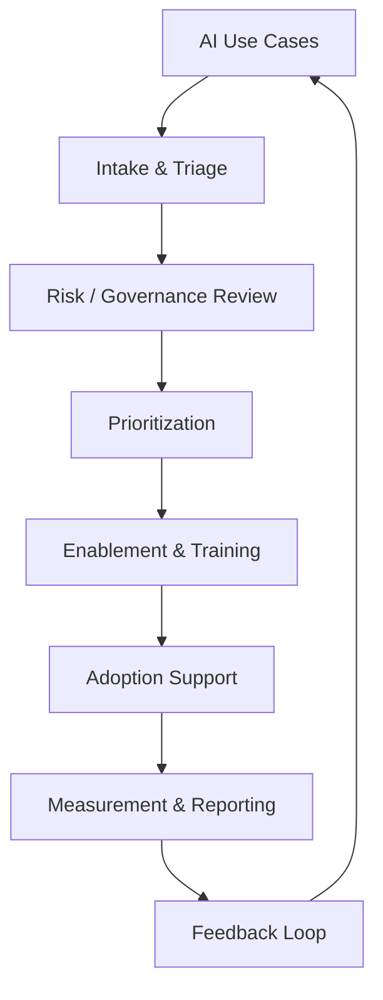

# Enterprise AI Enablement Operating System

> How do you make enterprise AI adoption repeatable instead of dependent on individual champions or isolated experiments?

**Portfolio category:** SYSTEM — *the ability to think in reusable components, operating models, and repeatable mechanisms rather than one-off screens.*

---

## The Problem

An enterprise technology organization is told to "adopt AI." That mandate has no owner, no intake process, no governance model, no way to measure whether it is working, and no plan for building the skills people need to use AI responsibly. Individual teams start experimenting on their own. Some use cases move fast and skip risk review. Others stall waiting for approval that doesn't exist yet. Leadership has no consistent way to see what is happening across the organization or whether it is producing value.

The result is a portfolio of disconnected pilots rather than a program.

## Why It Matters

Ambiguous, org-wide mandates fail in one of two ways: they get bottlenecked in ad hoc governance, or they proceed with no governance at all until something goes wrong. Neither produces adoption that lasts. An enterprise needs a system that lets good ideas move quickly *and* lets risk, security, and compliance stay in the loop — without requiring a committee meeting for every use case.

## My Role

I am the Lead Technical Program Manager for AI Strategy & Global Developer Enablement at JPMorganChase, Corporate Technology. I own program and project delivery for the Corporate Technology AI enablement portfolio — scope, timelines, budget, risk, and dependencies from concept through sustainment. I am the organization's reference point for how a new AI initiative gets structured, resourced, and governed.

This repository generalizes the operating model, governance approach, learning architecture, and reporting structure I use in that role into a reusable framework. Internal artifacts, exact policies, and proprietary details have been abstracted into example frameworks — see the [Source Notes](#source-notes) below for what is real versus illustrative.

## Context

- Highly matrixed enterprise environment spanning engineering, product, security, risk, and business stakeholder groups.
- No formal authority over most of the teams whose participation the program depends on.
- Multiple in-flight AI tools (Claude, Claude Code, GitHub Copilot) with different risk profiles, different user populations, and different rollout timelines.
- A workforce with wide variance in AI literacy — from developers already writing agentic workflows to business users who have never used a generative AI tool.
- A requirement to report AI adoption and value in a form executives (ED/MD, CIO/CTO) can act on.

## Approach

I treated the mandate as a system-design problem, not a single project. A system needs an intake point, a way to triage risk, a way to prioritize competing requests, a way to build the skills required to use what gets approved, a way to support adoption once it launches, and a feedback loop that improves the whole system over time. I designed each of those components so they connect to each other rather than existing as separate initiatives:

## Research

- Ran the **Listening Post Strategy**, a structured feedback program that collected 300+ submissions on AI literacy needs, friction points, and opportunity areas — surfaced before they became support escalations.
- Partnered with HR and Talent & Development to align a training curriculum to existing competency frameworks rather than inventing a parallel one.
- Worked directly with engineering, product, and security stakeholders to understand where governance was slowing adoption versus where it was protecting the firm.

## Key Insight

Adoption doesn't fail because people don't want to use AI. It fails because the organization has no consistent path from "I have an idea" to "I'm using this safely in production," and the parts of that path — intake, risk, training, support — are usually owned by different people who have never talked to each other. The fix is not more enthusiasm. It's a connected operating system.

## Solution / Recommendation

Built and lead a repeatable operating model with five connected components, detailed in this repository:

1. **Governance** — a triage and decision framework so risk review is proportional to actual risk, not uniform friction for every request.
2. **Intake & Prioritization** — a structured way to capture requests and score them against business value, feasibility, and risk.
3. **LevelUp Training Architecture** — a tiered curriculum (101 / 201 / 301) built with HR and Talent & Development so AI literacy scales past individual champions.
4. **Adoption Support** — a champion network and change-management approach (ADKAR, Kotter) that sustains usage after launch.
5. **Reporting** — a KPI framework and executive dashboard that translates adoption into decision-ready information for ED/MD and CIO/CTO stakeholders.

## Tradeoffs

- **Speed vs. rigor:** Lower-risk use cases move through a lightweight path; only use cases touching sensitive data or consequential decisions get full risk review. This means some use cases get less governance scrutiny than a "review everything" model would apply — deliberately, to keep the program from becoming a bottleneck.
- **Standardization vs. flexibility:** LevelUp uses one curriculum architecture for developers, UX designers, program managers, and business users rather than a bespoke track per role. That keeps the program maintainable at the cost of some role-specific depth, which is addressed through elective modules rather than parallel curricula.
- **Central ownership vs. grassroots ownership:** The program office owns the operating model, but adoption is driven through a champion network rather than mandates — slower to start, more durable once it takes hold.

## Outcome

Based on an anonymized enterprise AI adoption engagement. Programs built on this operating model pattern have driven 90%+ active adoption across independent organizations I've led (Salesforce at NextEra, Monday.com at Summit, and AI tooling adoption in Corporate Technology at JPMorganChase). The Listening Post Strategy alone generated 300+ structured submissions used to prioritize the current AI enablement roadmap.

## What I Would Do Next

- Formalize the maturity-model self-assessment (see [Adoption Maturity Model](operating-model/operating-model.md#adoption-maturity-model)) as a recurring quarterly checkpoint tied to investment decisions.
- Extend the KPI framework to connect adoption metrics directly to a small number of business-impact metrics (time saved, defect reduction, cycle time) rather than usage metrics alone.
- Build a lightweight self-service intake experience so the program office spends less time on manual triage and more on the use cases that actually need judgment.

## Artifacts

| Folder | Contents |
|---|---|
| [`operating-model/`](operating-model/) | Operating model, governance structure summary, operating cadence |
| [`governance/`](governance/) | Governance framework, risk decision tree, risk framework |
| [`intake/`](intake/) | AI use-case intake form, intake process |
| [`prioritization/`](prioritization/) | Scoring model, prioritization matrix |
| [`training/`](training/) | LevelUp curriculum architecture (101 / 201 / 301) |
| [`adoption/`](adoption/) | Adoption framework, champion network model, change management approach |
| [`reporting/`](reporting/) | KPI framework, executive dashboard mockup |
| [`templates/`](templates/) | RACI, status report, decision log templates |
| [`interview/`](interview/) | 30-second / 2-minute / 5-minute talking points |

## Skills Demonstrated

Program & portfolio management · Operating model design · AI governance & risk triage · Curriculum design · Change management (ADKAR, Kotter) · Executive reporting (Power BI) · Budget ownership · Cross-functional influence without formal authority

---

## Source Notes

- **Grounded in real experience:** role and scope at JPMorganChase; the existence and purpose of the AI enablement program, LevelUp curriculum, Listening Post Strategy (300+ submissions), Claude Code Issue Capture Agent, RAG pipelines, and executive reporting responsibilities.
- **Generalized for this portfolio:** specific governance decision trees, intake forms, scoring models, RACI structures, and dashboard data in this repository are illustrative frameworks informed by that experience — not reproductions of JPMorganChase's actual internal documents, policies, or data. No confidential information, internal system names, proprietary architecture, or real individuals appear anywhere in this repository.
