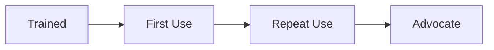

# Adoption Framework

> *Portfolio framework informed by enterprise AI program-management experience, including patterns proven in Salesforce adoption work at NextEra that achieved 90% active adoption within six months.*

## Principle

Training gets someone to first use. Sustained adoption requires reinforcement, visible peer usage, and a fast path to resolving friction — none of which a single training session can provide on its own.

## The Adoption Curve This Framework Targets

Most enablement programs invest almost entirely in getting people from "Trained" to "First Use" and then stop. This framework puts equal weight on "Repeat Use" and "Advocate," because that's where adoption either compounds or quietly reverts.

## Components

1. **Champion network** — see [Champion Network Model](champion-network.md)
2. **Change management approach** — see [Change Management](change-management.md)
3. **Friction feedback loop** — the Listening Post pattern: a standing, structured channel for surfacing friction before it becomes a support escalation or a quiet drop-off
4. **Reinforcement** — visible recognition of active use, embedded in existing team rituals rather than a separate program

## Why This Works

Adoption that depends on a mandate reverts the moment attention moves elsewhere. Adoption built on champions, reinforcement, and a fast feedback loop keeps compounding because the people driving it are embedded in the teams using the tool, not external to them.
