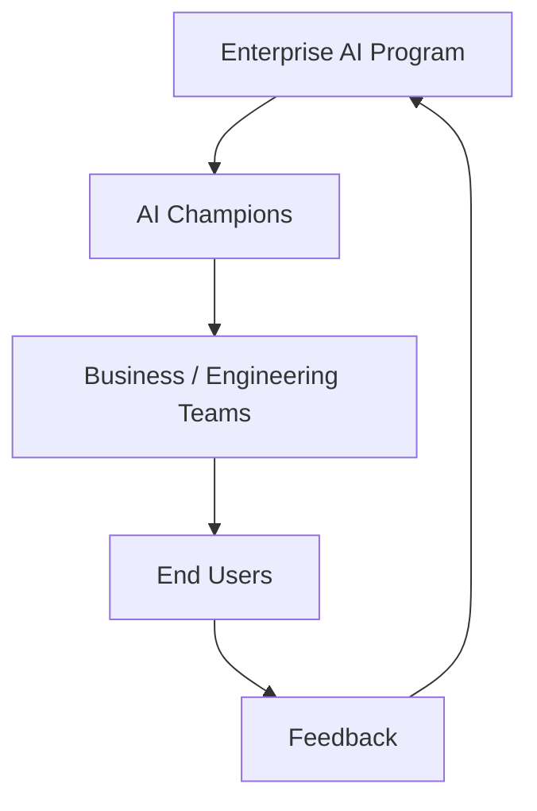

# Champion Network Model

> *Pattern informed by champion-community work built at NextEra during a Salesforce adoption program, generalized here for AI enablement.*

## Structure

## Why Champions, Not Mandates

A mandate gets compliance. A champion — a peer embedded in the team, not a program-office representative — gets trust. Champions answer the questions people are embarrassed to ask in a training session, model realistic use in their own work, and surface friction in language the program office can act on.

## Champion Role

- Model everyday use of approved AI tools in their own work
- Answer first-line questions before they become support tickets
- Surface recurring friction to the program office through the feedback loop
- Recognize and highlight good use within their team

## What the Program Office Owes Champions

- A direct line to the program team, not a generic support queue
- Early visibility into new tools, policy changes, and training updates
- Visible recognition — champions are named and credited, not anonymous volunteers
- A light time commitment with clear boundaries, so the role doesn't become an unpaid second job

## Why This Sustains Adoption

Champion networks reduce reliance on top-down mandates and were central to achieving 90% active adoption within six months in prior technology rollouts. The mechanism is the same for AI enablement: adoption sustained by peer trust survives leadership changes and shifting priorities better than adoption sustained by a directive.
