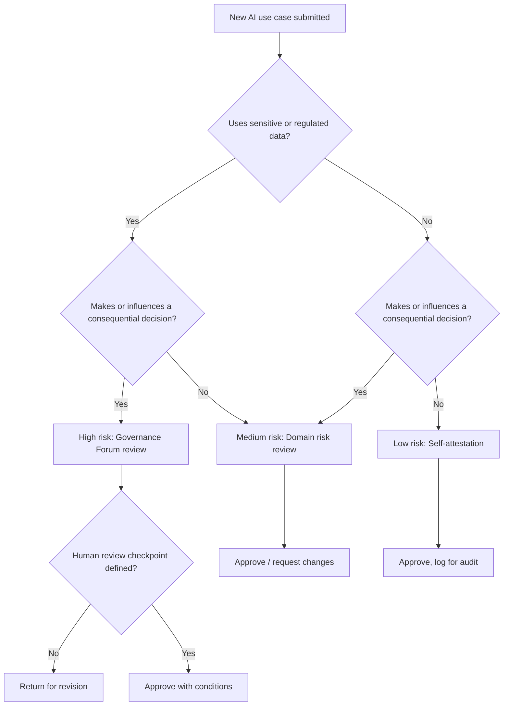

# Risk Decision Tree

> *Portfolio framework informed by enterprise AI program-management experience. This is an illustrative example built for this portfolio — it does not represent JPMorganChase's or any other employer's actual internal governance process, criteria, or thresholds.*

## Purpose

Give anyone submitting a new AI use case a fast, predictable answer to "how much review will this need?" — before they've invested time building it.

## Decision Tree

## How to Read This

- **Low risk** use cases move forward the same week — the requester attests to the criteria and logs the use case for visibility.
- **Medium risk** use cases get an async review from a domain risk contact, typically resolved within a few business days.
- **High risk** use cases go to the full Governance Forum and are not approved without a defined human review checkpoint and escalation path.

## Why Not Review Everything the Same Way

Uniform review either creates a backlog that discourages experimentation or normalizes light-touch review for use cases that deserve real scrutiny. Tiering by actual risk keeps the bar high where it matters and out of the way where it doesn't.
