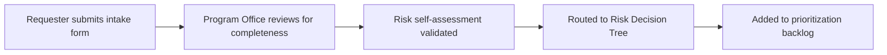

# Intake Process

> *Portfolio framework informed by enterprise AI program-management experience.*

## Flow

## Service-Level Targets

| Step | Target |
|---|---|
| Acknowledge submission | 1 business day |
| Complete triage | 3 business days |
| Route to Governance (if High risk) | 5 business days |

## Why a Defined SLA

A use case that sits untriaged for weeks doesn't just delay one team — it teaches the organization that the intake process isn't worth using, which pushes people back toward unmanaged, ungoverned experimentation. A visible SLA is part of what makes the front door of the system credible.
