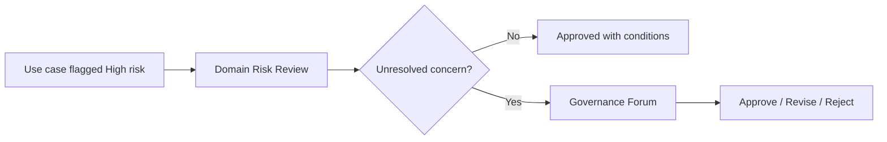

# Governance Structure

> *Portfolio framework informed by enterprise AI program-management experience. Illustrative structure, not a disclosure of any employer's actual governance body or membership.*

## Purpose

Define who has authority over what kind of decision, so a use case doesn't need every stakeholder in the room to move forward.

## Decision Rights by Risk Tier

| Risk Tier | Definition | Decision Owner | Review Required |
|---|---|---|---|
| Low | No sensitive data, no consequential decisions, reversible | Program Office | Self-attestation |
| Medium | Limited sensitive data or moderate operational impact | Program Office + Domain Risk Contact | Lightweight review (async) |
| High | Sensitive data, consequential decisions, or regulatory exposure | Governance Forum | Full review with documented sign-off |

## Governance Forum (Illustrative Composition)

- Executive Sponsor
- AI Program Lead
- Security representative
- Risk / Compliance representative
- Engineering representative
- Business stakeholder representative

The forum reviews only High-tier use cases and escalations from Medium-tier review. Low- and Medium-tier decisions are made without convening the full group, which keeps the forum's time focused on the requests that actually need it.

## Escalation Path

## Why Tiered Governance

A single review process applied uniformly to every use case either slows down the organization's simplest, lowest-risk experiments or under-scrutinizes its highest-risk ones. Tiering review effort to actual risk is what lets a program move quickly on the majority of requests while still applying real rigor where it matters.
