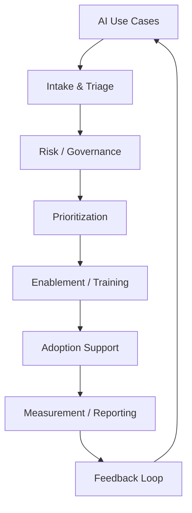

# Operating Model

> *Portfolio framework informed by enterprise AI program-management experience. Not a reproduction of any employer's actual internal operating model.*

## Purpose

Give an ambiguous "adopt AI" mandate a repeatable structure: a defined entry point for new ideas, a proportional way to assess risk, a way to decide what gets built first, a way to build the skills to use it, a way to support it after launch, and a way to know if any of it worked.

## System Architecture

Each stage hands off to the next through a defined artifact, not a conversation:

| Stage | Owner | Input | Output |
|---|---|---|---|
| Intake & Triage | Program Office | Use-case intake form | Triaged request with risk flag |
| Risk / Governance | Risk + Program Office | Triaged request | Approval, revision request, or rejection |
| Prioritization | Program Office + Sponsors | Approved requests | Ranked roadmap |
| Enablement / Training | Program Office + HR/Talent Dev | Roadmap, skill gaps | Trained, ready users |
| Adoption Support | Champions + Program Office | Trained users | Active usage, surfaced friction |
| Measurement / Reporting | Program Office | Usage + feedback data | Executive reporting, roadmap input |
| Feedback Loop | Program Office | Reporting insights | Refined intake criteria, curriculum updates |

## Adoption Maturity Model

A simple way to describe where a use case, team, or the organization as a whole sits, and what "better" looks like next.

| Level | Name | Characteristics |
|---|---|---|
| 1 | Experimenting | Individuals use AI tools independently; no shared process or visibility |
| 2 | Emerging | Teams establish repeatable use cases; still ad hoc across teams |
| 3 | Managed | Governance and measurement exist; intake and risk review are consistent |
| 4 | Scaled | Adoption is actively managed across the organization; reporting drives decisions |
| 5 | Embedded | AI use is part of normal operating practice, not a separate initiative |

The maturity model is used two ways: as a self-assessment for the program overall, and as a lens for evaluating whether a specific use case is ready to move from pilot to scale.

## Why This Structure

The most common failure mode in enterprise AI adoption isn't a lack of enthusiasm — it's that intake, risk, training, and support are owned by different people who never designed their handoffs to connect. This model makes the handoffs explicit so a use case doesn't stall between stages waiting for someone to notice it.
