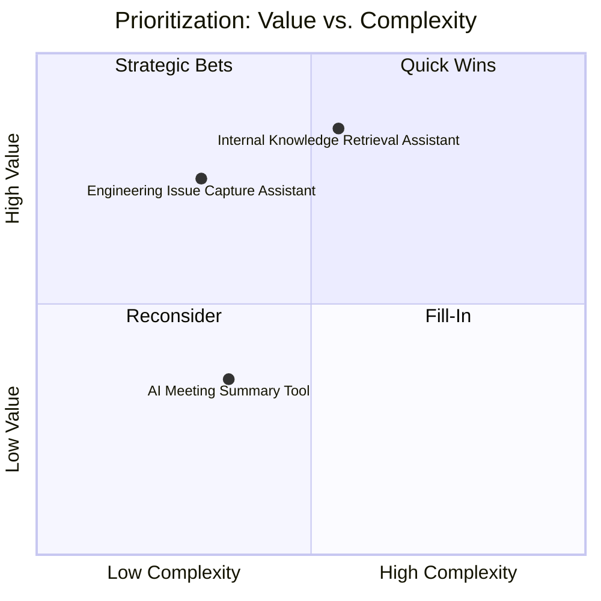

# Prioritization Matrix

> *Portfolio framework informed by enterprise AI program-management experience. Sample data only.*

## Value vs. Complexity View

## How to Use This View

- **Quick Wins** (low complexity, high value) move to the front of the roadmap.
- **Strategic Bets** (high complexity, high value) get sponsor-level commitment before they start, because they'll take longer to show results.
- **Reconsider** (low complexity, low value) get a second look — sometimes low value means the problem wasn't well understood at intake.
- **Fill-In** work fills capacity gaps but shouldn't drive the roadmap.

This view is a conversation tool for sponsors, not a mechanical ranking — it makes tradeoffs visible so the roadmap decision is a discussion about value and risk appetite, not just a spreadsheet sort.
