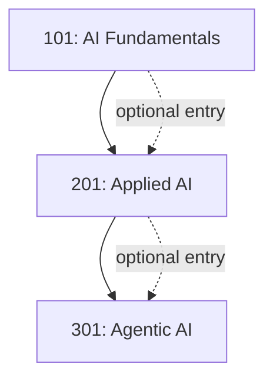

# LevelUp: Tiered AI Curriculum

## Grounding

LevelUp is a real program I built and lead at JPMorganChase, in partnership with HR and Talent & Development, to improve AI literacy across roles, skills, and ways of working for developers, UX designers, program managers, and business users org-wide. The tier structure and design principles below reflect how the curriculum is architected; specific internal course content and materials are not reproduced here.

## Why a Tiered Structure

A single training track for everyone from a first-time AI user to an engineer building agentic workflows either bores the advanced group or overwhelms the beginner group. Tiering by capability — not by role — lets a business user and a developer both start where they actually are.

## Tier Overview

| Tier | Audience | Focus |
|---|---|---|
| [101](level-101.md) | Anyone new to generative AI | Concepts, safe use, prompt basics |
| [201](level-201.md) | Regular users of AI tools | Applied, non-agentic workflows |
| [301](level-301.md) | Advanced practitioners | Agentic orchestration, RAG-aware design |

## Design Principles

- **Aligned to existing competency frameworks** rather than a standalone credential, so completion counts toward development plans people already have.
- **Role-relevant electives** layered on top of a shared core, so a UX designer and a developer complete the same fundamentals but different applied modules.
- **Delivered through existing HR/Talent Development channels**, not a separate learning platform, to reduce adoption friction.
- **Tied to the operating model**, not standalone — training content updates when the [Governance Framework](../governance/governance-framework.md) or tooling changes, so the curriculum doesn't go stale.

## Measuring Effectiveness

Training completion is a leading indicator, not the goal. LevelUp is measured against the [KPI Framework](../reporting/kpi-framework.md)'s Capability and Engagement metrics — did completion translate into sustained, appropriate use — not completion counts alone.
